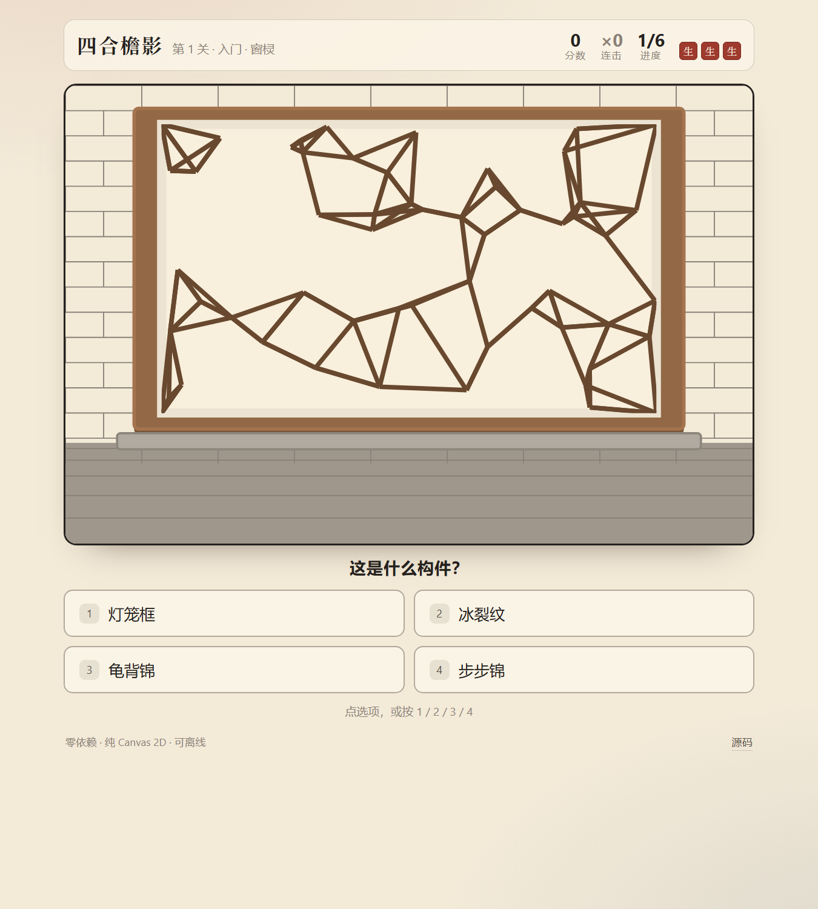
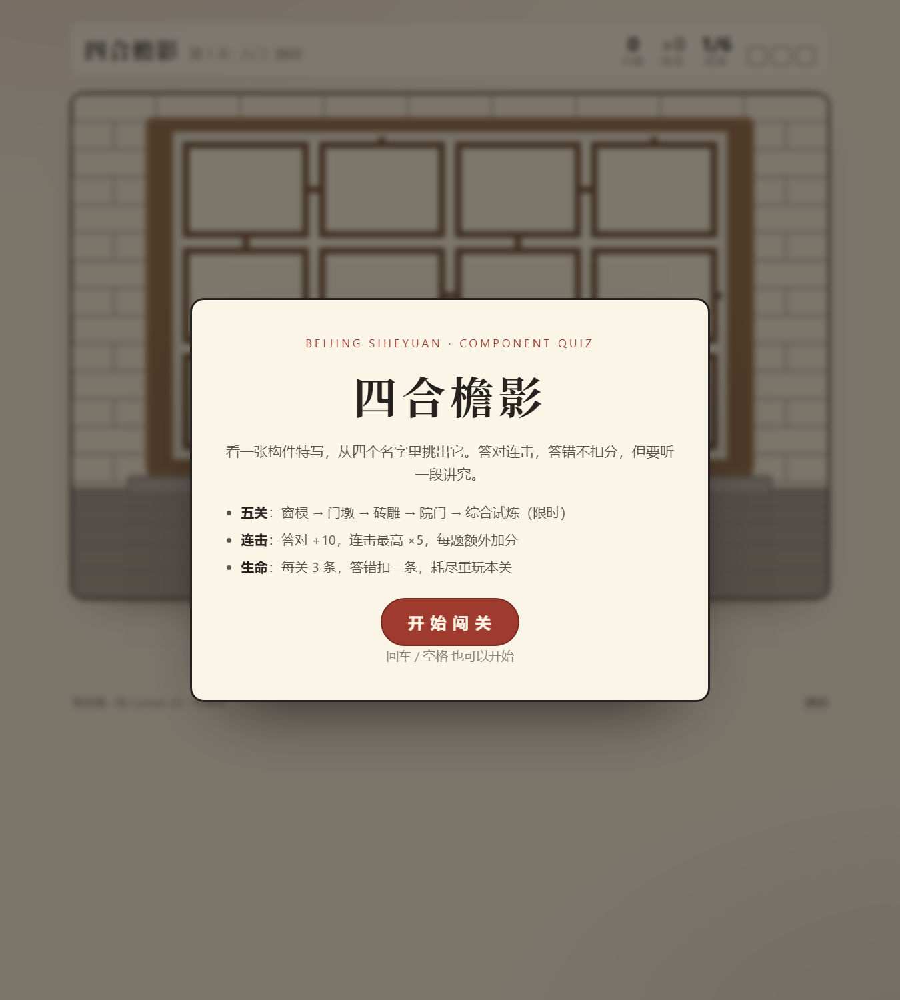
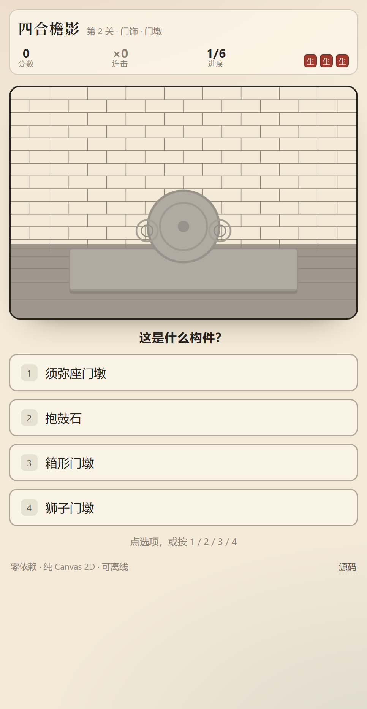

# 四合檐影 · 构件识别小游戏

> 看一张四合院构件特写，从四个名字里挑出它。五关、连击、生命、科普弹窗，通关发一张电子证书。

### 👉 在线直接玩：<https://hh200606.github.io/siheyuan-vision/>

**网页版零依赖、无构建、手机可玩；仓库里另有一份 Python + Pygame 桌面版。**



---

## 两个版本

| | 网页版（推荐） | 桌面版 |
| :-- | :-- | :-- |
| 位置 | `docs/` | `siheyuan_vision/` + `run.py` |
| 技术 | 原生 HTML/CSS/JS + Canvas 2D | Python 3.10+ 与 pygame 2 |
| 怎么玩 | 点上面的链接，或本地打开 `docs/index.html` | `pip install -r requirements.txt` 后 `python run.py` |
| 适合 | 分享、手机上玩、发朋友圈 | 后续接 OpenCV 摄像头识别的底子 |

两版共用同一套内容（五关、规则、构件词条）和同一套画法比例（600×400 逻辑坐标），所以看到的东西是一致的；逻辑层各自都有独立单测。

## 这是什么

一个把「北京四合院构件」做成识图闯关的小游戏，是我另一个项目 [siheyuan（四合院布局图解）](https://github.com/HH200606/siheyuan) 的衍生玩法：

- 布局图解回答「院子怎么摆」；
- 这个游戏回答「眼前这块构件叫什么，凭什么这么认」。

每道题都是「一个构件 + 四个名字」，玩家必须从形制差异里做判断，而不是背题库。

## 五关

| 关 | 主题 | 认什么 | 题量 |
| :-- | :-- | :-- | :-- |
| 1 | 入门 · 窗棂 | 步步锦 / 冰裂纹 / 龟背锦 / 灯笼框 | 6 |
| 2 | 门饰 · 门墩 | 狮子 / 抱鼓石 / 箱形 / 须弥座 | 6 |
| 3 | 檐下 · 砖雕 | 花草 / 博古 / 瑞兽 / 回纹 | 6 |
| 4 | 院门 · 大门形制 | 广亮门 / 金柱门 / 如意门 / 随墙门 | 6 |
| 5 | 综合试炼 | 四类混出 + **75 秒限时** | 8 |

## 规则

- 答对：+10 分，连击 +1；连击越高每题额外加分（×2 起，最高 ×5）
- 答错：**不扣分**，但生命 -1，并弹出这个构件的科普（答错才是学习发生的时候）
- 每关 3 条命，耗尽即本关失败，题目重出、重玩本关
- 第 5 关 75 秒；超时算本关失败
- 五关全通：按「实得分 / 理论最高分」评级 —— 学徒 / 匠人 / 大师，并生成电子纪念证书（网页版可直接下载 PNG）

理论上限 476 分：前四关各 88 分（连击到 ×5 后吃满），第五关 124 分。

## 操作

- 鼠标 / 手指点选项，或按 `1` `2` `3` `4`
- `回车 / 空格` 继续，`Esc` 退出
- 结算页：网页版点「保存证书」，桌面版按 `S` 存 PNG、`R` 重开

## 截图

| 开始 | 答题 |
| :-- | :-- |
|  |  |

| 手机端 | 通关证书 |
| :-- | :-- |
|  |  |

桌面版（Pygame）长这样：

| 答题 | 证书 |
| :-- | :-- |
|  |  |

每个类目的四个形制对照（自制，用来验收辨识度）：

```bash
python tools/contact_sheet.py
```

## 项目结构

```
siheyuan-vision/
├── docs/                     # ★ 网页版（GitHub Pages 从这里发布）
│   ├── index.html
│   ├── style.css
│   ├── js/
│   │   ├── content.js        # 五类构件词条 + 关卡表
│   │   ├── engine.js         # 状态机（纯逻辑，可在 node 里测）
│   │   ├── art.js            # Canvas 绘制（600×400 逻辑坐标）
│   │   └── app.js            # 界面、HUD、弹窗、证书
│   └── screenshots/
├── siheyuan_vision/          # ★ 桌面版（Pygame）
│   ├── config.py             # 尺寸、配色、关卡表、评级线
│   ├── questions.py          # 词条 + 出题逻辑
│   ├── game.py               # 状态机（纯逻辑，无 pygame）
│   ├── art.py                # 构件绘制（图元拼出来，无图片文件）
│   └── ui.py                 # 界面、交互、证书
├── tools/                    # 无头截图、对照表、冒烟测试
├── tests/                    # Python 单测 + 网页逻辑单测
├── run.py                    # 桌面版入口
└── requirements.txt
```

## 文档

| 文档 | 内容 |
| :--- | :--- |
| [产品需求文档（PRD）](docs/PRD.md) | 问题定义、目标与非目标、用户与指标、功能需求（FR-1～FR-9 含验收标准）、非功能要求、埋点、风险、发布清单 |
| [PRD Word 版](docs/四合檐影-PRD-v1.0.docx) | 同上，A4 排版，便于对外传阅（由 `tools/md2docx.py` 生成） |

## 两条设计取舍

**1. 为什么没有图片素材？**
找网上的古建筑照片有两个问题：版权不清、以及「照片里的构件」常被环境干扰，反而不如一张干净的特写好认。所以所有构件都是用图元画的示意图：窗棂的棂条、门墩的轮廓、砖雕的题材、院门的门道深浅，都按形制特征来画。代价是不写实，好处是**每一类只保留能区分彼此的特征**，两版共用同一套画法。

**2. 逻辑与渲染分离**
`game.py` / `engine.js` 都不碰渲染，所以两边都能在无头环境里跑完整流程的测试（连击上限、生命耗尽、超时、评级）。渲染层只负责把状态画出来。

## 测试

```bash
# 网页版逻辑（11 项）
node --test tests/web-engine.test.js

# 桌面版逻辑（13 项）
python -m unittest discover -s tests

# 桌面版冒烟：无头跑一遍点击、答题、存证书
python tools/smoke.py
```

## 路线图

- [ ] **OpenCV 摄像头模式**（桌面版）：拍现实里的构件，用模板匹配 / 特征匹配给候选，玩家确认
- [ ] 题库扩充：墀头、影壁、垂花门、栏杆、柱础
- [ ] 音效：古风点击音、答对清脆音、失败低频音
- [ ] 记分挑战：本地最高分与连击纪录

## 许可

[MIT](LICENSE)
