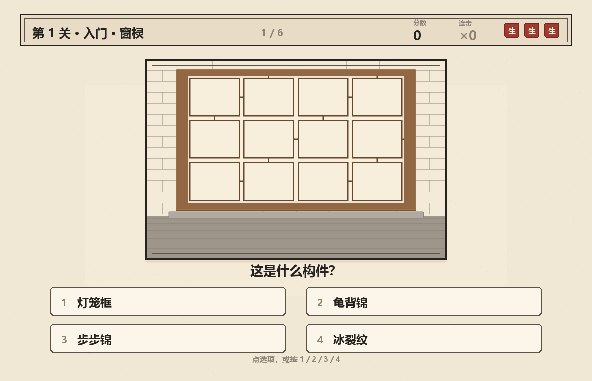
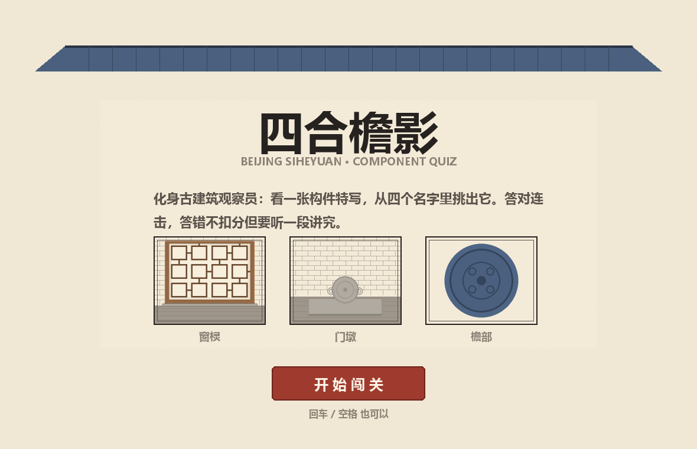
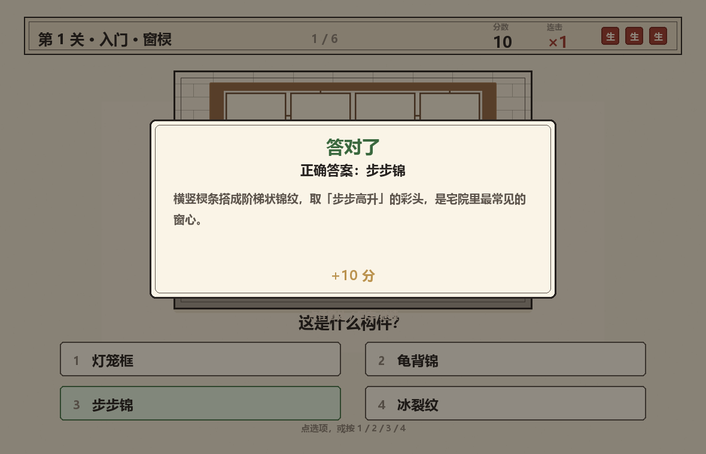
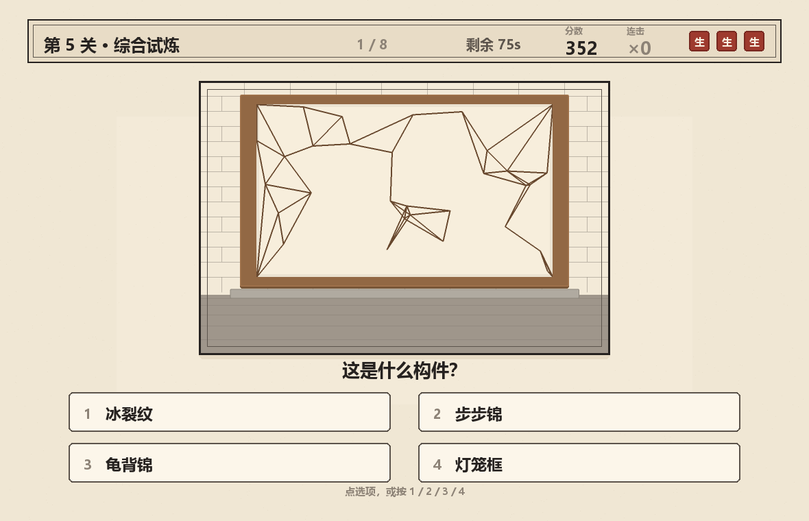
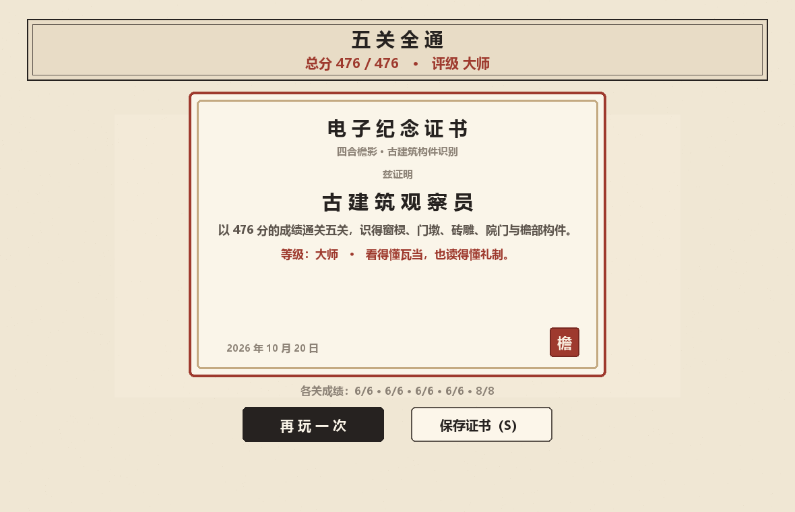

# 四合檐影 · 构件识别小游戏

> 看一张构件特写，从四个名字里挑出它。五关、连击、生命、科普弹窗，通关发一张电子证书。

**Python 3.10+ · pygame 2 · 零图片素材（全部用代码画出来）**



---

## 这是什么

一个把「北京四合院构件」做成识图闯关的小游戏。它是我另一个项目 [siheyuan（四合院布局图解）](https://github.com/HH200606/siheyuan) 的衍生玩法：

- 布局图解回答「院子怎么摆」；
- 這個游戏回答「眼前这块构件叫什么，凭什么这么认」。

每一道题都是「一个构件 + 四个名字」，玩家必须从形制差异里做判断，而不是靠背题库。

## 五关

| 关 | 主题 | 认什么 | 题量 |
| :-- | :-- | :-- | :-- |
| 1 | 入门 · 窗棂 | 步步锦 / 冰裂纹 / 龟背锦 / 灯笼框 | 6 |
| 2 | 门饰 · 门墩 | 狮子 / 抱鼓石 / 箱形 / 须弥座 | 6 |
| 3 | 檐下 · 砖雕 | 花草 / 博古 / 瑞兽 / 回纹 | 6 |
| 4 | 院门 · 大门形制 | 广亮门 / 金柱门 / 如意门 / 随墙门 | 6 |
| 5 | 综合试炼 | 四类混出 + **75 秒限时** | 8 |

## 规则

- 答对：+10 分，连击 +1；连击越高每题额外加分（×2 起，最高 ×5）
- 答错：**不扣分**，但生命 -1，并弹出这个构件的科普（答错才是学习发生的时候）
- 每关 3 条命，耗尽即本关失败，题目重出、重玩本关
- 第 5 关 75 秒；超时算本关失败
- 五关全通：按「实得分 / 理论最高分」评级 —— 学徒 / 匠人 / 大师，并生成电子纪念证书（可存成 PNG）

理论上限 476 分：前四关各 88 分（连击到 ×5 后再吃满），第五关 124 分。

## 运行

```bash
pip install -r requirements.txt
python run.py
```

- 鼠标点击选项，或按 `1` `2` `3` `4`
- `回车 / 空格` 继续，`Esc` 退出，结算页 `R` 重开、`S` 存档证书
- 窗口 1180×760，不依赖任何外部素材或网络

## 截图

| 标题 | 答对反馈 |
| :-- | :-- |
|  |  |

| 限时关 | 通关证书 |
| :-- | :-- |
|  |  |

每个类目的四个形制对照（自制，用来验收辨识度）：

```bash
python tools/contact_sheet.py
```

## 项目结构

```
siheyuan-vision/
├── run.py                    # 入口
├── siheyuan_vision/
│   ├── config.py             # 尺寸、配色、关卡表、评级线
│   ├── questions.py          # 五类构件词条 + 出题逻辑
│   ├── game.py               # 状态机（纯逻辑，无 pygame，可单测）
│   ├── art.py                # 全部构件绘制（图元拼出来的，无图片文件）
│   └── ui.py                 # 界面、交互、证书
├── tools/
│   ├── capture.py            # 无头截图（SDL dummy）
│   └── contact_sheet.py      # 四形制对照图
└── tests/test_game.py        # 13 项逻辑测试
```

## 两条设计取舍

**1. 为什么没有图片素材？**
找网上的古建筑照片有两个问题：版权不清、以及「照片里的构件」常常被环境干扰，反而不如一张干净的特写好认。所以这里所有构件都是用 pygame 图元画的示意图：窗棂的棂条、门墩的轮廓、砖雕的题材、院门的门道深浅，都按形制特征来画。代价是它不写实，好处是**每一类只保留能区分彼此的特征**。

**2. 逻辑与渲染分离**
`game.py` 不 import pygame，所以 13 项测试可以在无头环境里跑完整个流程（连击上限、生命耗尽、超时、评级）。`ui.py` 只管把状态画出来。

## 测试

```bash
python -m unittest discover -s tests -v
```

覆盖：选项集合正确且答案在内、不连续重复出题、混合关轮转五类、连击计分与上限、答错不扣分但扣命、生命耗尽→重玩本关、超时失败、全对得满分且评级为大师。

## 路线图

- [ ] **OpenCV 摄像头模式**：调用摄像头拍现实里的构件，用 `cv2.matchTemplate` / 特征匹配给出候选，玩家确认（原需求的进阶版）
- [ ] 题库扩充：墀头、影壁、垂花门、栏杆、柱础
- [ ] 音效：古风点击音、答对清脆音、失败低频音
- [ ] 打包成网页版（pygbag / Pyodide），这样也能直接挂 GitHub Pages

## 许可

[MIT](LICENSE)
